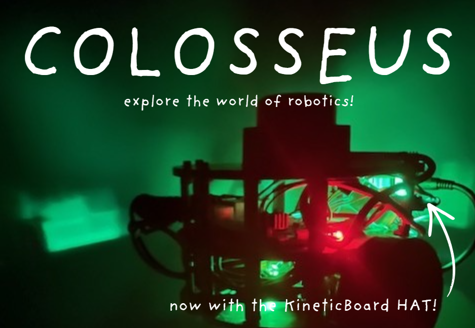
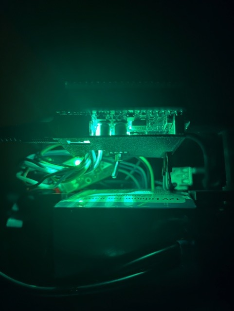
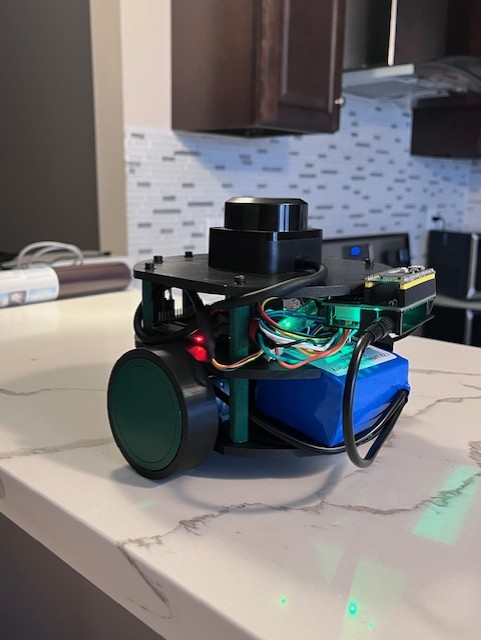
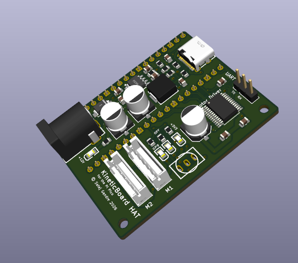
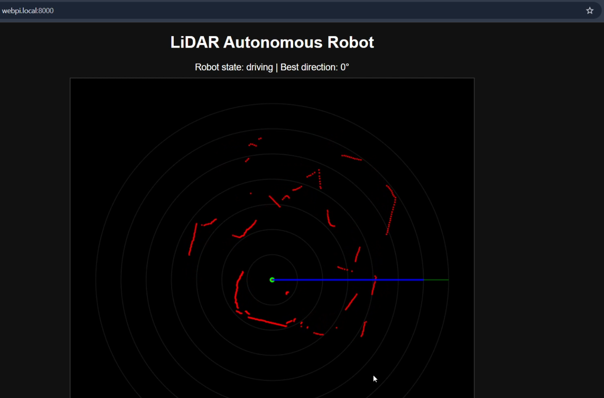

# Colosseus
A simplified, stackable robotics platform for students, hobbyists, and instructors! 

*Click the image above to see the demo video.*

## What's Colosseus?
Colosseus is designed to be a two-wheeled robot that is easy to program and to learn. Its main feature is its stackable design, allowing more and more boards, often called "levels", to be added on top of it like a stack of pancakes. The demo version of Colosseus, which is featured in this repo, comes with a lidar as the main sensor on top. Colosseus comes with some basic libraries and demo programs to help users get started with the platform quickly and easily.

*random cool image of Colosseus from the back (I couldn't help myself from including this pic)*
## How Does It Work?
- **Raspberry Pi 4**: Essentially Colosseus' "brain." It collects and processes information from various sensors and makes decisions based on them. You could substitute this with any Raspberry Pi SBC board, including a Pi Zero, as long as you have the proper adapters. It connects to the KineticBoard HAT via UART to issue movement commands.

- **Add-ons / LiDAR**: It can detect nearby objects using what's essentially a rotating ToF sensor. The exact  model is an RPLidar C1. It is not necessary for every Colosseus; however, I thought it would make for a great demo, so I kept it in my version. I encourage you to tinker with the 3D models of the layers to add more sensors and modules!

- **KineticBoard HAT**: While the main Pi is busy handling computations and serving an interactive website, the KineticBoard HAT moves Colosseus by spinning the motors. I designed this PCB in KiCAD, and it simplifies motor control, power distribution, and communication with it's many ports. Currently, it takes in a +12V barrel jack input, and converts it to +5V to supply power to the Pi Pico and to a USB-C receptacle for general purpose use. In my design, the receptacle's power is used to keep the Raspberry Pi 4 running. There are two sets of 6-pin adapters which perfectly match the cables that are used to connect the +12V encoder motors. There is also a 3-pin breakout for UART communication with the Raspberry Pi SBC.
    - **LED Signal Codes**
        - Near the barrel jack: +12V detected
        - Upper right hand side: +3.3V is on (Pico connected successfuly)
        - Middle right hand side: +5V (but not +3.3V)
        - *The bottom right led is for general purpose. More info can be found in KiCAD schematic.*

- **KineticLib**: I created a custom library in C to make it easier for other users to directly program the KineticBoard's Pico. Specifically, the library's header files are `Encoder.h`, `Motor.h`, `Direction.h`, and `PID.h`. 

- **WebUI (Demo)**: In my demo, `server.py`, the Pi hosts a web app using uvicorn to create WebSocket connections, allowing users to "see" Colosseus' perspective as it navigates.

## Repository Structure
* The folders `Chassis` and `KineticBoardHAT` pertain to the M-CAD/E-CAD portions of this project, respectively.

* `Firmware` contains firmware for the KineticBoard HAT's Raspberry Pi Pico microcontroller. Each demo project can be found in the `projects` directory in the submodule. These will need to be converted into a `.uf2` format by a `gcc-arm-none-eabi` cross-compiler. AI was not used in this aside from some gentle debugging and CMake guidance. All of the code is authentic.

* The Python scripts that run on the Raspberry Pi SBC are found in the `Software` folder. To set up the RPLidar C1, refer to this [video](https://www.youtube.com/watch?v=i5bt5gLs7zo). I took help from AI to improve the navigation algorithm in `server.py` and `manual_drive.py`, so run those scripts at your own risk.

## BOM
This is list of the parts that I needed for this project. `BOM/lcsc.csv` contains the LCSC parts needed, and `BOM/tools.csv` lists the parts required for the rest of the robot from other online retailers like Amazon. Alternatively, I've added it to this README below:
### KineticBoard Assembly
| Designator                                    | Footprint                                      | Quantity | Value                       | LCSC Part # |
|-----------------------------------------------|------------------------------------------------|----------|-----------------------------|-------------|
| C1, C10                                       | 0402                                           | 2        | 1uF                         | C52923      |
| C11, C12, C17, C2, C3, C4, C5, C6, C7, C8, C9 | 0402                                           | 11       | 0.1uF                       | C1525       |
| C13, C14, C18                                 | 0603                                           | 3        | 10uF                        | C96446      |
| C15, C16                                      | 0402                                           | 2        | 33pF                        | C1562       |
| C19, C21, C22, C24, C25                       | 0402                                           | 5        | 100nF                       | C1525       |
| C20                                           | 0805                                           | 1        | 22uF                        | C1804       |
| C23                                           | CP_EIA-7343-31_Kemet-D                         | 1        | 100uF                       | C7469933    |
| D1, D2                                        | D_SMA                                          | 2        | SS14                        | C2480       |
| J1                                            | USB_C_Receptacle_HRO_TYPE-C-31-M-12            | 1        | USB_C_Receptacle_USB2.0_14P | C165948     |
| J2, J3                                        | PinHeader_1x20_P2.54mm_Vertical                | 2        | Conn_01x20                  |             |
| J5                                            | BarrelJack_CUI_PJ-102AH_Horizontal             | 1        | Barrel_Jack_Switch          | C3096093    |
| J6                                            | TerminalBlock_MaiXu_MX126-5.0-02P_1x02_P5.00mm | 1        | Motor A                     | C5188434    |
| J7                                            | TerminalBlock_MaiXu_MX126-5.0-02P_1x02_P5.00mm | 1        | Motor B                     | C5188434    |
| L1                                            | 0805                                           | 1        | 4.7uH                       | C48945383   |
| R1, R2                                        | 0402                                           | 2        | 5.1K                        | C25905      |
| R3, R4                                        | 0402                                           | 2        | 27                          | C25156      |
| R5, R7                                        | 0402                                           | 2        | 1K                          | C11702      |
| R6                                            | 0402                                           | 1        | 10K                         | C25744      |
| SW1                                           | SW_Push_SPST_NO_Alps_SKRK                      | 1        | SW_Push                     | C115357     |
| U1                                            | QFN-56-1EP_7x7mm_P0.4mm_EP3.2x3.2mm            | 1        | RP2040                      | C2040       |
| U3                                            | Winbond_USON-8-1EP_3x2mm_P0.5mm_EP0.2x1.6mm    | 1        | W25Q16JVZPIQ TR             | C2843335    |
| U4                                            | TSOT-23-6                                      | 1        | AP63203WU                   | C780769     |
| U5                                            | SSOP-24_5.3x8.2mm_P0.65mm                      | 1        | TB6612FNG                   | C88224      |
| U6                                            | SOT-23                                         | 1        | MCP1700x-330xxTT            | C39051      |
| Y1                                            | Crystal_SMD_3225-4Pin_3.2x2.5mm                | 1        | 12 MHz                      | C9002       |
### Reflow Soldering Station
- [Solder Paste](https://www.amazon.com/gp/product/B08KR7W7SQ/ref=ox_sc_act_title_1?smid=A2GPLZGUK8NBW5&psc=1) ~$13
- [Solder Flux](https://www.amazon.com/gp/product/B0D2DC28XF/ref=ox_sc_act_title_2?smid=A3FX7C4A9P37IQ&psc=1) ~$10
- [Hot Plate](https://www.amazon.com/gp/product/B0G443BG4X/ref=ox_sc_act_title_3?smid=AWT2BCWPY562U&psc=1) ~$30
- [Extra Precise Tweezers](https://www.amazon.com/gp/product/B0D6RRJNRQ/ref=ox_sc_act_title_4?smid=ALGTK11E8KWSQ&psc=1) ~$14
### Robot
- [2pcs Motors w/ Encoders](https://www.amazon.com/XiaoR-Motor-Encoder-100RPM-Ratio/dp/B0FFMK7CLT) ~$31
- [Li-Ion Battery Pack](https://www.amazon.com/Zenshynix-Rechargeable-Lithium-Ion-High-Capacity-Telescope/dp/B0G1SW4JHR) ~$19
- [Screw Assortment Kit](https://www.amazon.com/HanTof-Countersunk-Assortment-Phillips-Threaded/dp/B0FF4RFTN6/ref=sr_1_9) ~$8
- Raspberry Pi 4B+ 4GB (I already own this)
- 32GB MicroSD Card (I already own this)
- RPLidar C1 (I already own this)
- Chassis Parts (I have cheap access to a 3D printer at my local library)

### Totals
- Cost of the linked parts: $125
- JLCPCB PCB + Stencil Order: $30
- LCSC Parts: $22

**Total Cost: ~$177**

---
#### AI Statement
AI was used in the revision of the python scripts in the Software submodule. It was used to debug various parts of my project, and to double check certain systems before I tested them (including the PCB, albiet to a much lesser extent).